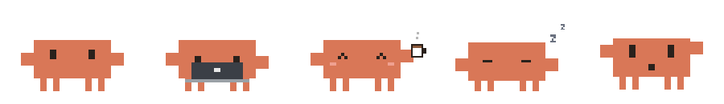

# PomoPet: a Pomodoro timer that lives on your desktop

A small orange pixel buddy sits on your desktop with a speech bubble showing the countdown.

* **Click** the pet to start / pause. **Drag** it anywhere. **Double-click** to open Tasks & Settings.
* **Right-click** (the pet or the tray icon) for: start/pause, reset, skip, always-on-top, start with Windows, hide, exit.
* Focus, short break and long break lengths are customizable, and so is "long break every N sessions".
* When a focus session ends you get a sound, a Windows notification, and a jumping pet telling you to take a break.
  The break can start automatically (on by default), and you are reminded again when the break is over.
* To-do list: add tasks, pick the one you are working on (shown in the bubble), and mark them done.
  Each task counts the pomodoros spent on it. Today's totals are shown at the bottom of the panel.
* Pet moods: idle (blinks, looks around), focus (typing on a laptop), break (coffee, happy eyes),
  paused (dozing, "z z"), session finished (jumping).

Settings and tasks are saved to `%APPDATA%\PomoPet\config.json`.

## Build
Requires Go 1.21+ on any OS: `./build.sh` produces `PomoPet.exe` (Windows x64, no dependencies).
